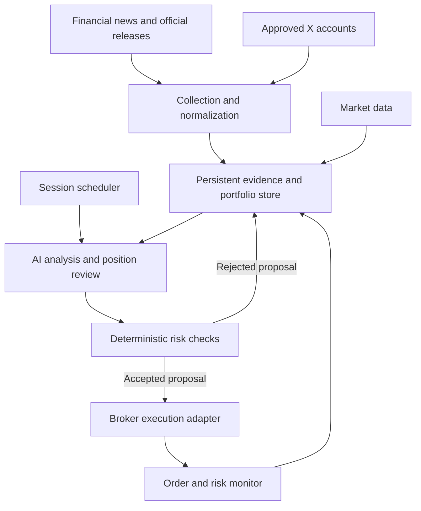

# Agentic Trading Workflow

AI-assisted trading with scheduled decision sessions, persistent news context, and independent risk controls.

This document defines the proposed architecture and implementation roadmap. The capabilities and milestones below are planned unless explicitly marked complete. The first implementation target is paper trading.

## Project goal

Every configurable number of hours, the system starts a decision session that reviews open positions and evaluates new opportunities using:

- News published or first acquired within the previous three hours.
- Relevant historical news and events.
- Posts from an explicitly approved list of X accounts.
- Current market data, portfolio holdings, pending orders, and previous decisions.

A session can open, increase, maintain, reduce, or close a position. It can also make no changes. Each decision must reference its supporting evidence and explain the conditions that would invalidate its thesis.

The initial research objective is to determine whether this information improves decisions and performance after trading and operating costs.

## Operating schedule

News collection, decision sessions, and execution monitoring run independently.

| Process | Proposed starting frequency | Responsibility |
| --- | --- | --- |
| Source collection | Every 5 minutes | Fetch new authorized content, record acquisition times, and recover missed items |
| AI decision session | Every 3 hours; configurable to X hours | Review existing holdings, evaluate opportunities, and propose actions |
| Order and risk monitoring | Continuous while applicable markets are active | Track fills, protections, exposure, data freshness, and operational failures |
| Session reporting | After every session | Save evidence, proposals, risk outcomes, execution status, and costs |

Market calendars and time zones must be explicit. Store timestamps in UTC and use the selected exchange calendar for market-open checks. Only one decision session per portfolio may run at a time.

If sessions are more than three hours apart, process the unhandled backlog since the last successful session as well as the latest three-hour window. If they are closer together, identify evidence already considered. A restart must not silently lose news or repeat trades.

## Architecture

The AI analyzes evidence and proposes actions. A deterministic risk engine validates those proposals, and an execution adapter submits permitted orders. Credentials and policy configuration remain outside model-controlled content.

## Authorized information sources

### Financial publications

Use selected financial publications through supported APIs, RSS feeds, or licensed data feeds. Examples to evaluate include Reuters, Financial Times, The Wall Street Journal, and Milano Finanza. Actual coverage depends on available access and compatible rights for retrieval, retention, and model processing.

Do not assume that a public headline permits storing or forwarding the full article. Preserve provider-specific usage restrictions, and process only content available through authorized access.

### Primary sources

Prioritize company investor-relations releases, earnings reports, regulatory filings, central-bank announcements, and official economic releases when available. Distinguish original disclosures from commentary and articles repeating them.

### X accounts

Maintain an explicit whitelist controlled by the project owners:

- Stable account ID and current username.
- Inclusion rules for original posts, replies, quote posts, and reposts.
- Approved topics or instruments where appropriate.
- Source configuration version and operational status.

Use the official X API with author filtering and incremental cursors. Recent Search covers the previous seven days; older historical coverage requires an appropriately authorized archive source or permitted retained data.

Being on the whitelist makes an account eligible for collection. Claims still require evaluation and, where appropriate, corroboration. Source permissions, API access, and content-retention obligations must be reviewed before enabling a connector.

## Evidence pipeline and persistent memory

For each source item, record:

- Provider, source item ID, account or publisher, and canonical URL.
- Publication time, first-seen time, fetch time, and revision time when available.
- The accessible text or permitted reference, language, and content hash.
- Related companies, instruments, topics, and event identifiers.
- Whether the item is an original disclosure, commentary, rumor, correction, or repeated report.
- Extraction results and the versions of the source connector and analysis configuration.

Deduplicate by source ID and content hash, then group reports concerning the same underlying event. Repeated coverage must not be counted as independent confirmation.

Each session receives three context layers:

| Layer | Contents |
| --- | --- |
| Recent information | Items first acquired within the last three hours, with publication-age labels, plus any unprocessed backlog |
| Relevant history | Earlier disclosures, related events, contradictory evidence, and previous context for the instruments under review |
| Position memory | Entry thesis, supporting evidence, invalidation conditions, review deadline, previous decisions, and execution outcomes |

Persist these layers independently of the LLM conversation. Retrieve relevant history by instrument, event, and time; add semantic retrieval if simpler filters prove insufficient.

Distinguish a newly published event from an old article discovered late. Preserve corrections and historical versions subject to source rules. During evaluation, use only the version that was available at the simulated decision time.

## Decision-session workflow

1. Acquire a portfolio-level lock and establish a session ID and evidence cutoff.
2. Reconcile cash, holdings, pending orders, and fills with the broker.
3. Check feed availability, quote freshness, market status, and source coverage.
4. Load recent evidence, unprocessed backlog, relevant history, and position theses.
5. Review existing positions first: maintain, reduce, close, or update a thesis.
6. Evaluate new opportunities within the approved instrument universe.
7. Produce structured proposals with traceable evidence and explicit uncertainties.
8. Validate proposals against deterministic risk and execution rules.
9. Recheck portfolio state and quote freshness immediately before submission.
10. Submit permitted orders, record acknowledgements, and monitor partial fills.
11. Save the session report and processing checkpoints, then release the lock.

Commit processing checkpoints only after the corresponding durable results are recorded. A proposal is not an executed trade, and an acknowledgement is not a confirmed fill.

### Proposal contract

| Field | Purpose |
| --- | --- |
| Session and proposal IDs | Traceability and duplicate prevention |
| Instrument and action | Approved symbol and proposed position change |
| Thesis | Event interpretation and expected mechanism |
| Evidence IDs and URLs | Supporting and contradictory sources |
| Information cutoff | Latest time included in the analysis |
| Horizon and expiry | Expected holding period and proposal validity |
| Invalidation conditions | Evidence or price conditions requiring reassessment |
| Proposed exposure and protections | Inputs to the deterministic sizing and risk engine |
| Uncertainty | Missing information, source conflicts, and alternative explanations |

Actions: `OPEN`, `INCREASE`, `HOLD`, `REDUCE`, `CLOSE`, and `NO_ACTION`.

Model confidence is initially qualitative. Do not interpret a generated confidence score as a calibrated probability of profit.

## Risk and execution controls

Configure risk rules independently of the model:

- Approved instruments and permitted actions.
- Maximum position size, gross exposure, sector concentration, and portfolio risk.
- Maximum daily loss using realized and unrealized P&L, including applicable costs.
- Minimum liquidity, maximum spread, and quote-freshness requirements.
- Maximum concurrent positions and outstanding orders.
- Protective-order requirements and maximum holding or review periods.
- A manual kill switch and defined recovery procedures.

For the first prototype, propose long-only paper trading without leverage. Numeric thresholds are configuration decisions to settle before implementing execution.

If a critical feed is missing or stale, stop new risk-taking and continue reconciliation and protection monitoring. Define failure responses before development; a kill switch must not implicitly mean liquidating every holding.

Use broker-managed protective orders where supported. Confirm their activation after fills and keep protection quantities aligned with partial fills. Stops do not guarantee execution at the trigger price, and protection support varies by broker, instrument, and trading session.

Assign stable client order IDs. After a timeout, query order status before retrying. Test interrupted submissions, duplicate callbacks, partial fills, cancellations, reconnection, and recovery after restart.

Treat all retrieved articles and posts as untrusted data. Embedded instructions must never alter the whitelist, risk limits, permissions, or execution tools.

## Proposed technology stack

| Component | Initial proposal |
| --- | --- |
| Core services | Python |
| Persistent storage | PostgreSQL |
| News collection | Provider-specific API and RSS adapters |
| Scheduling | A scheduler triggering durable session jobs |
| AI | Provider-independent LLM client with validated structured output |
| Historical retrieval | Instrument/event/time queries; optional semantic retrieval |
| Execution | Broker adapter with a paper environment first |
| Monitoring | Independent worker consuming order updates and reconciling state |
| Interface | Dashboard for positions, evidence, decisions, costs, and system status |
| Verification | Focused tests for temporal integrity, risk gates, execution, and recovery |

Alpaca is a candidate for a US-equities paper prototype. Market, broker, exchange support, data entitlements, and eventual live-account eligibility remain open decisions.

Track separate budgets for news feeds, X API usage, LLM calls, market data, and hosting. Cache reusable analysis without bypassing freshness checks or source-retention rules.

## Reference repositories

The following projects are candidates for reuse or architectural study. The comparison was reviewed on **2026-10-09** using repository documentation and selected source files. It is not an end-to-end execution audit or a profitability assessment.

| Repository | Relevant capabilities | Fit for Agentic Trading Workflow | Gaps or checks |
| --- | --- | --- | --- |
| [TradingCrew](https://github.com/rminchev1/TradingCrew) | Documents multi-agent analysis, news and social sentiment, analysis every N hours, Alpaca integration, optional execution, and a portfolio dashboard | Closest documented match to the intended product | Verify scheduler and execution implementations; inspect X ingestion, whitelist enforcement, memory, and the three-hour evidence window |
| [TradeAgent](https://github.com/enving/TradeAgent) | LLM news sentiment combined with technical signals, multiple news providers, Alpaca paper trading, persistent logging, and risk controls | Strong candidate for the operational bot and risk/execution structure | Its inspected scheduled-scan script runs once per invocation, so periodic triggering needs an external scheduler; evaluate or add X collection and configurable evidence windows |
| [TradingAgents](https://github.com/TauricResearch/TradingAgents) | Python/LangGraph analyst and research agents, news and sentiment analysis, portfolio context, persistent decision memory, and noninteractive CLI runs | Strong candidate for the analysis engine | Connect collection and execution services; its current documented social inputs include StockTwits and Reddit, so approved-account X collection needs evaluation |
| [AI Hedge Fund](https://github.com/virattt/ai-hedge-fund) | Roadmap documents persistent paper portfolios, session records, idempotent paper ticks, a kill switch, and backtesting | Useful reference for stateful sessions and the decision ledger | Built-in scheduling is in progress, social connectors and live broker integration are planned; verify current implementation before relying on those features |

### Recommended evaluation order

1. **TradingCrew:** inspect how scheduled analyses review holdings and interact with Alpaca; verify documented capabilities in source and paper tests.
2. **TradeAgent:** inspect its news pipeline, deterministic limits, execution adapter, and externally scheduled scans.
3. **TradingAgents:** evaluate it as the replaceable AI analysis engine if building a custom service around it is preferable.
4. **AI Hedge Fund:** study persistent session state, paper-tick idempotency, and its event ledger.

Select one starting point after a small paper-only technical spike. Compare maintainability, licensing, test coverage, provider costs, temporal correctness, and the effort required to meet the exact source requirements. Check the license and notices of the specific revision before importing code. No upstream code is adopted by this plan.

## Implementation roadmap

| Milestone | Deliverable | Acceptance criteria |
| --- | --- | --- |
| 0. Scope and upstream evaluation | Choose market, instruments, broker candidate, source whitelist, budgets, and starting architecture | Document decisions; run one reproducible paper-only spike; identify upstream gaps |
| 1. Evidence collection | Authorized connectors, normalized records, cursors, revision tracking, and event deduplication | No silent gaps across restarts; repeated reports are grouped; timestamps and source references are retained |
| 2. AI analysis | Scheduled sessions, historical retrieval, position review, and validated proposals | Every actionable proposal has valid evidence, an expiry, and invalidation conditions; incomplete inputs are reported |
| 3. Risk and paper execution | Deterministic gates, broker reconciliation, protected orders, and an independent monitor | Duplicate prevention and partial-fill handling pass; hard limits cannot be changed by the model |
| 4. Evaluation | Historical replay where valid, prospective paper trading, and benchmark comparison | Include costs, latency assumptions, data gaps, drawdown, turnover, and exposure; preserve prompt and configuration versions |
| 5. Dashboard and operations | Session reports, source health, positions, audit history, cost tracking, alerts, and a kill switch | Failures and stale feeds are visible; recovery and halt/resume procedures are demonstrated |
| 6. Live-readiness review | Separate decision about a limited live deployment | Broker access, applicable requirements, operating procedures, and evaluation evidence are reviewed; live mode remains disabled until explicitly configured |

Do not treat paper profitability as sufficient evidence for deployment. Paper fills can omit liquidity constraints, market impact, and latency-related slippage.

## Validation approach

Use chronological train/development and held-out evaluation periods where applicable. Freeze strategy rules, prompts, and configuration before evaluating a held-out period. Compare against a relevant passive benchmark and a simple strategy without LLM analysis.

Measure net returns, maximum drawdown, risk-adjusted performance, exposure, concentration, turnover, trading costs, data/model costs, and operational failures. Report results by period and market regime.

Historical news must be available as of each simulated decision, including filing delays and revisions. Modern LLMs may already know outcomes of historical events; historical replay therefore requires leakage analysis and prospective paper testing.

Operational tests must cover missing feeds, malformed proposals, unauthorized instruments, stale quotes, simultaneous sessions, rejected orders, partial fills, timeout-after-submit, duplicated events, and restart recovery.

## Open decisions

- Asset class, exchanges, and initial instrument universe.
- Decision interval X and whether sessions also run outside market hours.
- Intended holding horizon and allowed position actions.
- Financial-news providers and approved X accounts.
- Historical coverage and permitted retention by source.
- Broker, market-data subscriptions, and operating budget.
- LLM provider, model selection, and per-session call budget.
- Exact risk thresholds and daily-loss halt policy.
- Preferred upstream starting point after the technical spike.

## Documentation and source links

- [X Recent Search](https://docs.x.com/x-api/posts/search/quickstart/recent-search)
- [X search query construction](https://docs.x.com/x-api/posts/search/integrate/build-a-query)
- [X Full-Archive Search](https://docs.x.com/x-api/posts/search/quickstart/full-archive-search)
- [X API pricing](https://docs.x.com/x-api/getting-started/pricing)
- [X Developer Policy](https://docs.x.com/developer-terms/policy)
- [Alpaca paper trading](https://docs.alpaca.markets/us/docs/paper-trading)
- [Alpaca order handling](https://docs.alpaca.markets/us/docs/orders-at-alpaca)
- [TradeAgent scheduled-scan source](https://github.com/enving/TradeAgent/blob/main/run_scheduled_trading.py)
- [AI Hedge Fund implementation roadmap](https://github.com/virattt/ai-hedge-fund/blob/main/ROADMAP.md)
