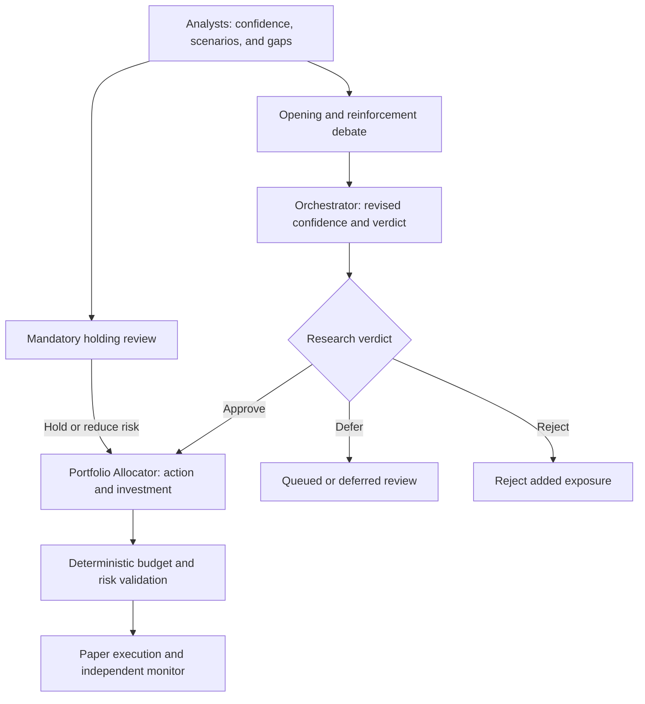

# Architecture and project scope

[Wiki home](README.md) · [Project overview](../README.md)

## Project goal

Every configurable X hours, four analysts research selected stocks and every existing holding. The team publishes initial confidence, payoff/downside scenarios, and known gaps; admissible proposals proceed directly to debate. Bull and Bear then challenge eligible additions, the Orchestrator defines revised confidence and payoffs, and a separate Portfolio Allocator agent chooses position actions and investment amounts.

The first implementation target is long-only paper trading. Every capability described here is a planned design unless explicitly marked complete. The research objective is to measure whether specialist analysis, debate, and confidence-based allocation improve decisions after trading and operating costs.

### Stock universe and time horizons

- `selected_stocks` is a user-configured watchlist; agents cannot expand new-entry eligibility.
- `analysis_universe = selected_stocks union broker-held stocks`. Removed watchlist stocks remain mandatory holding-research targets and may be reduced or closed, but cannot be reinforced without explicit eligibility.
- The recent-news window and decision interval each default to three hours, independently configurable. Research includes relevant history and unprocessed backlog.
- Propose a five-trading-day primary forecast horizon, frozen before evaluation. Each position also has a thesis-review deadline.
- New candidates have no current holding or pending opening order. Reinforcements are existing-position additions and require the same debate and investment review as openings.
- A session may leave exposure unchanged and reject every addition. Actions must cite evidence and thesis-invalidating conditions.

## Architecture

All admissible additions enter a bounded, fair debate queue without a confidence, payoff, or score filter. Missing initial estimates are disclosed for verification; unresolved final inputs defer investment. Rejection of an addition does not skip the holding's research or block risk reduction.

### Role ownership

There are **eight AI roles**:

| Role | Owns | Does not own |
| --- | --- | --- |
| Four specialist analysts | Market, financial, company, and social research; stock forecasts, initial `p_initial`, payoffs, and opportunity score | Orders or final capital allocation |
| Bull and Bear researchers | Competing evidence-backed cases for eligible `OPEN` and `REINFORCE` proposals | Policy changes or allocation |
| Orchestrator | Coordinates research/debate, judges the debate, publishes revised `p_final`, payoffs, opportunity score, and reasons | Position action or investment amount |
| Portfolio Allocator | Independently analyzes the confidence record and portfolio; chooses `OPEN`, `REINFORCE`, `HOLD`, `REDUCE`, `CLOSE`, or `NO_ACTION`, and proposes investment | Rewriting confidence, bypassing research verdicts or risk limits, or direct broker submission |

One of the four analysts also serves as Analyst Lead for team synthesis; propose the Financial Analyst initially. It is a responsibility within the analysis team, not a ninth role. Independent specialist reports are completed before the lead synthesizes them.

The AI Orchestrator coordinates the research workflow. A code-controlled workflow runtime handles durable jobs, locks, coverage checks, fair debate queues, reservations, policy enforcement, sizing tools, and execution. Only deterministic services can authorize and submit orders. Credentials and configuration stay outside model-controlled content.

## Proposed technology stack

| Component | Initial proposal |
| --- | --- |
| Core services | Python |
| Persistent storage | PostgreSQL |
| News collection | Provider API and RSS adapters |
| Scheduling | Durable session jobs |
| AI | Four analysts, Bull/Bear researchers, Orchestrator, and Portfolio Allocator; provider-independent clients with structured output |
| Retrieval | Instrument/event/time queries; optional semantic retrieval |
| Budget and risk | Deterministic tools exposing caps, available cash, permitted quantities, and reservations |
| Execution | Paper broker adapter first |
| Monitoring | Independent order-update and reconciliation worker |
| Interface | Dashboard for evidence, both confidence stages, decisions, investments, budgets, and costs |
| Verification | Temporal integrity, confidence routing, risk gates, execution, and recovery checks |

Alpaca remains a candidate for a US-equities prototype. Broker, exchange, data entitlement, and live eligibility decisions remain open. Track separate operating budgets for news, X API, LLMs, market data, and hosting.

## Related pages

- [Analysis team](analysis-team.md)
- [Forecasts and confidence](forecasts-and-confidence.md)
- [Opportunity analysis](opportunity-analysis.md)
- [Portfolio Allocator](portfolio-allocator.md)
- [Session workflow](session-workflow.md)
- [Implementation plan](PLAN.md)
