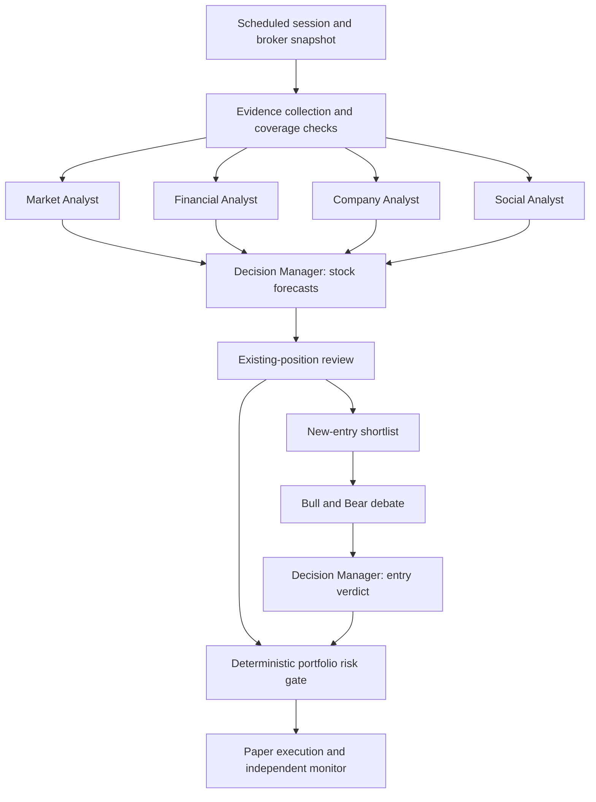

# Architecture and project scope

[Wiki home](README.md) · [Project overview](../README.md)

## Project goal

Every configurable X hours, a four-agent analysis team researches a selected group of stocks, produces evidence-backed forecasts, and reassesses every open position. New-entry proposals are challenged by a Bull Researcher and a Bear Researcher before a Decision Manager makes a judgment.

The required sequence is: collect and actively research evidence, publish stock forecasts, review current holdings, debate shortlisted new entries, validate portfolio-level risk, and execute permitted paper orders.

The first implementation target is long-only paper trading. Every capability described here is a planned design unless explicitly marked complete.

The initial research objective is to measure whether specialist analysis and debate improve decisions after trading and operating costs.

### Stock universe and time horizons

- `selected_stocks` is a user-configured watchlist; the system must not expand the new-entry universe by itself.
- `analysis_universe = selected_stocks union broker-held stocks`. Held stocks remain mandatory research targets even after removal from the watchlist.
- Existing holdings removed from the watchlist remain eligible for review and risk reduction, but cannot be reinforced without explicit eligibility.
- The recent-news window defaults to three hours, supplemented by relevant historical evidence and any unprocessed backlog.
- The decision interval defaults to three hours. It is independent of the forecast horizon.
- Propose a five-trading-day primary forecast horizon for the first experiment, configurable before evaluation. Each position also carries its own thesis review deadline.
- New candidates are stocks in the watchlist with no current holding or pending opening order. Reinforcements follow the existing-position path.

A session may leave exposure unchanged and reject every new entry. Each action must cite its evidence and the conditions that would invalidate its thesis.

## Architecture

There are seven AI roles: four analysts, two debate participants, and one Decision Manager. The same Decision Manager role synthesizes forecasts, reviews positions, nominates candidates, and judges debates in separate structured stages.

Scheduling, source permissions, coverage validation, portfolio limits, order sizing, and execution are code-controlled services. Credentials and policy configuration remain outside model-controlled content.

Analysts run independently against the same evidence cutoff and reconciled portfolio snapshot. They do not see one another's conclusions until their reports are complete. Shared evidence is attributed and deduplicated.

## Proposed technology stack

| Component | Initial proposal |
| --- | --- |
| Core services | Python |
| Persistent storage | PostgreSQL |
| News collection | Provider-specific API and RSS adapters |
| Scheduling | A scheduler triggering durable session jobs |
| AI | Four analyst roles, Bull/Bear researchers, and a Decision Manager; provider-independent clients with validated structured output |
| Historical retrieval | Instrument/event/time queries; optional semantic retrieval |
| Execution | Broker adapter with a paper environment first |
| Monitoring | Independent worker consuming order updates and reconciling state |
| Interface | Dashboard for positions, evidence, decisions, costs, and system status |
| Verification | Focused tests for temporal integrity, risk gates, execution, and recovery |

Alpaca is a candidate for a US-equities paper prototype. Market, broker, exchange support, data entitlements, and eventual live-account eligibility remain open decisions.

Track separate budgets for news feeds, X API usage, LLM calls, market data, and hosting. Cache reusable analysis without bypassing freshness checks or source-retention rules.

## Related pages

- [Analysis team](analysis-team.md)
- [Session workflow](session-workflow.md)
- [Implementation plan](PLAN.md)
