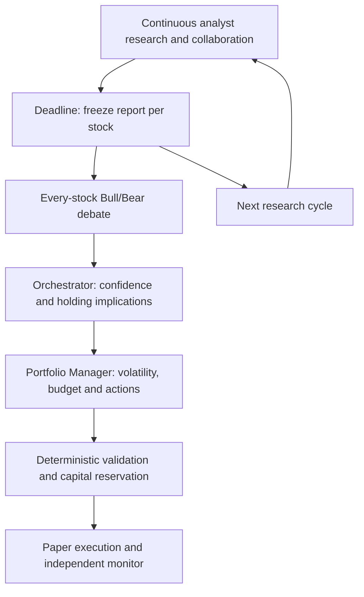

# Architecture and project scope

[Wiki home](README.md) · [Project overview](../README.md)

## Project goal

Throughout each configurable X-hour cycle, four analysts process news, perform targeted research, exchange findings and record revisions for selected stocks and every holding. At cycle end, freeze a report per analyzed stock; every report enters Bull/Bear debate. The Orchestrator defines revised confidence/payoffs and holding implications, and a separate Portfolio Manager evaluates volatility, budget and portfolio state to choose actions and investment amounts. New research continues while the closed cycle is debated.

The first implementation target is long-only paper trading. Every capability described here is a planned design unless explicitly marked complete. The research objective is to measure whether specialist analysis, debate, and confidence-based allocation improve decisions after trading and operating costs.

### Stock universe and time horizons

- `selected_stocks` is a user-configured watchlist; agents cannot expand new-entry eligibility.
- `analysis_universe = selected_stocks union broker-held stocks`. Removed watchlist stocks remain mandatory holding-research targets and may be reduced or closed, but cannot be reinforced without explicit eligibility.
- The recent-news window and research-cycle duration each default to three hours, independently configurable. A decision phase follows cycle closure; its latency is not part of X. Research includes relevant history and unprocessed backlog.
- Propose a five-trading-day primary forecast horizon, frozen before evaluation. Each position also has a thesis-review deadline.
- New candidates have no current holding or pending opening order. Reinforcements are existing-position additions and require the same debate and investment review as openings.
- A session may leave exposure unchanged and reject every addition. Actions must cite evidence and thesis-invalidating conditions.

## Architecture

All analyzed stock reports enter a bounded, fair debate queue without a confidence, payoff, or score filter. Missing initial estimates are disclosed for verification; unresolved final inputs defer investment. Rejection of an addition does not skip the holding's research or block risk reduction.

### Role ownership

There are **eight AI roles**:

| Role | Owns | Does not own |
| --- | --- | --- |
| Four specialist analysts | Market, financial, company, and social research; stock forecasts, initial `p_initial`, payoffs, and opportunity score | Orders or final capital allocation |
| Bull and Bear researchers | Competing evidence-backed stock-thesis cases, including existing holdings and eligible additions | Policy changes or allocation |
| Orchestrator | Coordinates research/debate, judges the debate, publishes revised `p_final`, payoffs, opportunity score, and reasons | Position action or investment amount |
| Portfolio Manager | Independently analyzes the confidence record and portfolio; chooses `OPEN`, `REINFORCE`, `HOLD`, `REDUCE`, `CLOSE`, or `NO_ACTION`, and proposes investment | Rewriting confidence, bypassing research verdicts or risk limits, or direct broker submission |

One of the four analysts also serves as Analyst Lead for team synthesis; propose the Financial Analyst initially. It is a responsibility within the analysis team, not a ninth role. Each specialist records an original per-item assessment before cross-review; final reports retain revisions and dissent before lead synthesis. The Manager is the existing Allocator role under the selected target name, not a ninth role.

The AI Orchestrator coordinates the research workflow. A code-controlled workflow runtime handles durable jobs, locks, coverage checks, fair debate queues, reservations, policy enforcement, sizing tools, and execution. Only deterministic services can authorize and submit orders. Credentials and configuration stay outside model-controlled content.

## Concrete proposed stack

Target Python 3.12/3.13 with LangGraph, Pydantic contracts, OpenRouter through HTTPX, PostgreSQL/SQLAlchemy/Alembic for business state, durable scheduled jobs and Alpaca paper execution. Owner interaction is a single Textual terminal with four panes: open positions, selected position, research chatbot and portfolio/performance. Separate collectors, session worker, execution worker and order monitor in the full target. The initial [v0.1 CLI](cli.md) has local SQLite/PostgreSQL research persistence and read-only broker access; distributed jobs, persistent graph checkpoints and execution are not yet implemented.

The [stack comparison](implementation-stack.md) also covers adapting existing repos, TypeScript/Mastra, and a later Temporal upgrade. Exact dependency versions and source access must be proven in T0; no runtime or connector is installed by this plan.

The selected provider target is Alpaca for broker/market data, yfinance for primary news/press-release leads, and AgentReach-backed tools for bounded page/search/approved-X/transcript research. SEC/IR and official macro evidence remain primary sources. Earlier Alpaca/Benzinga-news, Tavily and official-X defaults become explicit optional alternatives. See [provider plan](provider-plan.md), [research workflow](research-workflow.md), and [memory design](memory-and-retrieval.md). Alpaca is a proposed US-equities paper target, not a claim of account eligibility, source entitlement, or full market coverage.

Implementation specifications:

- [Connector APIs and coverage proofs](connector-implementation.md)
- [Agent tools and graph stages](agent-runtime.md)
- [Tables, contracts, and concurrency](persistence-and-contracts.md)
- [Deployment and operating-cost estimates](deployment-and-costs.md)
- [Ordered implementation backlog](implementation-backlog.md)

## Related pages

- [Analysis team](analysis-team.md)
- [Forecasts and confidence](forecasts-and-confidence.md)
- [Opportunity analysis](opportunity-analysis.md)
- [Portfolio Manager](portfolio-allocator.md)
- [Session workflow](session-workflow.md)
- [Implementation stack](implementation-stack.md)
- [Implementation plan](PLAN.md)

