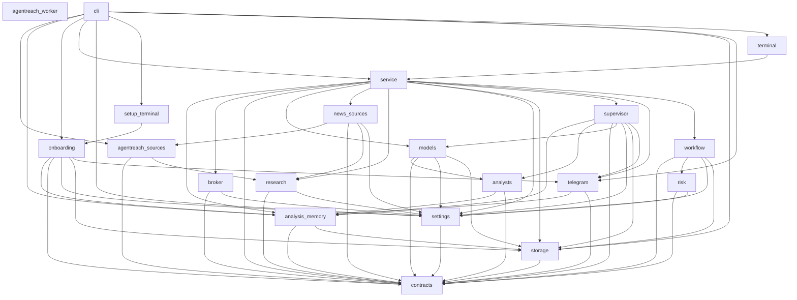

# Codebase map

[Wiki home](README.md) · [CLI guide](cli.md)

Generated from tracked Python source using `python tools/export_code_map.py`. The JSON includes file hashes, module imports and definitions. Import edges are static dependencies, not resolved call paths or test coverage.

**Graphify:** uninstalled by the owner on 2026-10-10. No Graphify export or indexed commit is claimed. [Status record](graphify-status.json). This map is a separate AST export.

The CLI drives application services. Workflow uses model/retrieval adapters and deterministic risk previews; storage persists research and read-only snapshots. The broker adapter has no submission method.

[Machine-readable map](codebase-map.json) contains 21 modules, 62 import edges and 280 definitions.
