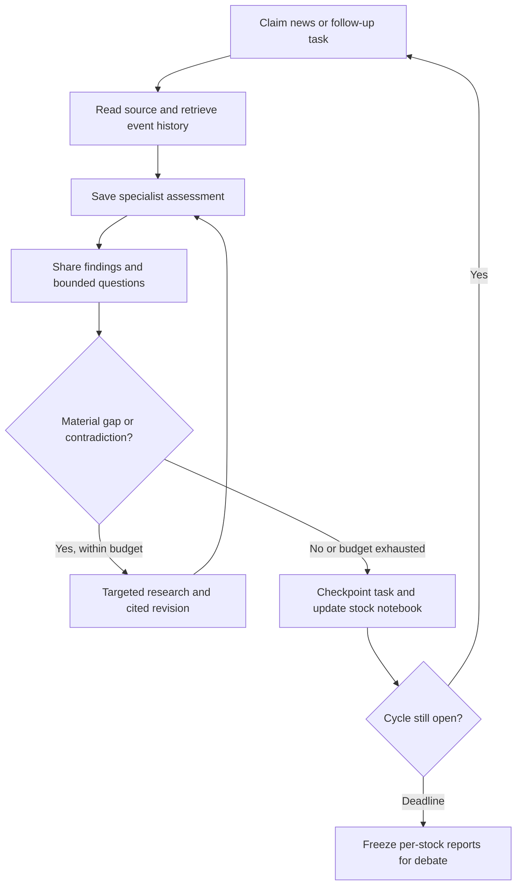

# Continuous analyst cycles and portfolio management

[Wiki home](README.md) · [Research tools](research-workflow.md) · [Memory](memory-and-retrieval.md)

The [agent control-loop blueprint](agent-control-loop.md) gives the concrete
per-task role contracts, persistence, and staged implementation.

**Owner update, 2026-10-10; target only.** Analysts work throughout a configurable
X-hour research cycle, collaborate on findings, and publish one report per analyzed
stock at its end. Every report enters debate. The Portfolio Manager then assesses
the selected cases against market volatility, capital and the whole portfolio.

This supersedes the earlier target of a single analyst pass every X hours and
debates restricted to opening/reinforcement proposals. The current v0.1 still uses
that older runnable subset; this page does not claim continuous agents are implemented.

## Cycle timing

Use durable fixed windows `[cycle_start, cycle_end)`, initially X = 3 hours.
Collectors poll independently, initially every five minutes. Analysts are persistent
logical workers: they wake for queued news, corrections, unresolved questions and
required stock lookups. They do not repeatedly call an LLM while idle.

At the deadline, close admission to the cycle, freeze a report manifest, and start
the next research cycle immediately. Debate and portfolio decisions consume the
closed cycle without stopping research. Only one decision/allocation run per
portfolio owns the allocation lease; research uses separate task/cycle leases.

X is the research-cycle duration, not a guaranteed trade interval. Reporting and
debate add latency. The three-hour recent-publication window remains a separate
setting; a longer cycle also includes accumulated items and unprocessed backlog
with their true publication/observation dates. Missing news is not invented to fill
a time window, and an event missed by the selected sources remains a coverage gap.

## Per-news processing loop

1. Claim an event/version task atomically, load the position thesis and relevant
   stored context, and retrieve the accessible original source when necessary.
2. Each assigned specialist writes its own first assessment before reading other
   assessments for that task. Preserve evidence IDs, assumptions, impact, uncertainty
   and open questions. One event can affect several stocks and specialist roles.
3. Share findings through the durable research notebook. Another analyst may add a
   different perspective, challenge a claim or answer a question. A typed message
   names event/stock, claim IDs, evidence and requester; it is not free-form chatting.
4. Start with one bounded cross-review exchange per event version; additional rounds
   require a new material fact/question and remaining budget. Repeated agreement is
   not new evidence and must not inflate confidence. Keep dissent rather than force consensus.
5. Persist revisions, unresolved questions and completed-task IDs, then claim the
   next item. Avoid refetching the same source separately for each analyst.

Not every specialist must comment on every article. Dispatch by scope, but every
analyzed stock receives the four-category coverage assessment. Every held stock is
included even without new headlines and receives actual fresh stock-specific lookups
within the cycle plus a closing freshness check under a versioned maximum-age policy.

## Budget and recovery

Reserve operating capacity for mandatory holdings, report generation and their
debates. Enforce per-item tool limits, cycle cost/token/time limits, source quotas,
bounded retries and maximum in-flight tasks. A slow event cannot starve unrelated
news; requeue unfinished work fairly, with its reason and last progress timestamp.

Budget exhaustion leaves pending tasks and explicit gaps. It does not silently
remove a stock report or apply a confidence/payoff admission filter. Source workers,
broker reconciliation and protective monitoring continue independently of AI spend.

Task idempotency uses cycle/event/evidence-version/role/stage/prompt-version keys.
Checkpoint after durable results; resume a pending task from its saved state. A
correction is a new version linked to its predecessor, not a repeated original item.
Persisted results are reused; ambiguous remote outcomes remain recorded for recovery.

## Deadline and reports

At `cycle_end`, atomically record the set of eligible evidence, assessments and
unresolved tasks. Reports may be assembled after the deadline, but can cite only
manifest members recorded before it. Give in-flight work a short bounded shutdown;
anything completed later remains in storage for the next cycle, not the closed report.
Freeze manifest IDs before asynchronous report assembly; late writes cannot change it.

The Financial Analyst's lead stage synthesizes one report per stock. Preserve:

- Company/ticker identity, cycle dates and evidence cutoff.
- Market, financial, company and social findings, including changes from prior cycles.
- Original-source evidence, interpretations, contrary claims and corrections.
- Held-position thesis comparison, invalidation conditions and pending commitments.
- Initial confidence/scenarios, explicit horizon/reference-price basis and calibration status.
- Coverage, unfinished questions, freshness and suggested next research.

Emit an incomplete report when sources or analysis fail. Do not disguise it as a
researched HOLD. Analyzed stocks include the selected watchlist and all holdings;
mentioned outsiders can be contextual research but are not automatically entry-eligible.

## Debate for every analyzed stock

Each closed stock report creates one durable debate obligation, regardless of
confidence or potential. Include held stocks and cases expected to result in HOLD
or NO_ACTION. Use bounded Bull/Bear rounds and versioned verification as specified
in [stock debate](new-entry-debate.md). Missing initial estimates remain explicit.

Fund the configured universe's debate workload; process required holding cases first,
then the same fair last-debated/stock-ID order without economic ranking. If time or
cost runs out, show unfinished obligations and mark the cycle decision phase partial.
Never claim every stock was debated when some were queued. Superseding an obsolete
case requires an explicit linked revision retaining its history and unresolved concerns.

The Orchestrator records `p_final` and APPROVE/DEFER/REJECT for added exposure, plus
thesis validity, dissent and holding implications. A rejected addition is not an
instruction to liquidate an existing position. Pass holding outcomes to the Manager
too, so it can choose HOLD/REDUCE/CLOSE. Incomplete cases cannot add capital.

New evidence arriving during debate belongs to the next cycle. If material for an
immediate decision, explicitly refresh the case/cutoff, affected reports and debate,
with new lineage; never append it silently to the frozen report. Existing deterministic
protections and policy-triggered risk reduction do not wait for a scheduled debate.

## Portfolio Manager

The target name replaces Portfolio Manager for the same eighth AI role, not an
extra manager. It receives all completed debate/holding outcomes and a fresh Alpaca
snapshot, produces one coherent portfolio plan, and can fund only a subset of
approved candidates. It cannot change the Orchestrator's final confidence or policy.

Assess measured market/stock volatility, stressed scenario loss, liquidity/spreads,
correlated and sector exposure, pending orders, cash reserves, portfolio drawdown and
deployment limits. State the data source, measurement window and freshness. Missing
volatility/risk inputs defer additions; volatility is not an LLM impression.

Confidence continues to affect investment, with the stressed-loss ceiling and cash/
exposure constraints limiting the amount. High confidence does not erase volatility.
The Manager chooses OPEN/REINFORCE/HOLD/REDUCE/CLOSE/NO_ACTION and explains amount,
portfolio effects, review time and limiting constraints. Code recomputes limits and
reserves capital; paper submission remains behind the existing execution milestone.

## Acceptance cases

Use a simulated clock, independent of real multi-hour waits. Test news arriving
throughout a cycle; idle wake-up; bounded collaboration; original/dissent preservation;
duplicate/corrected events; crash/resume; task starvation; exhausted budget; evidence
exactly on the boundary; late task completion; every-stock debate obligations; stale
case revisions; research continuing during decision work; and one portfolio-wide
Manager plan with volatility/cash/pending-exposure limits. Model quality and provider
availability require separate measured evaluations.
