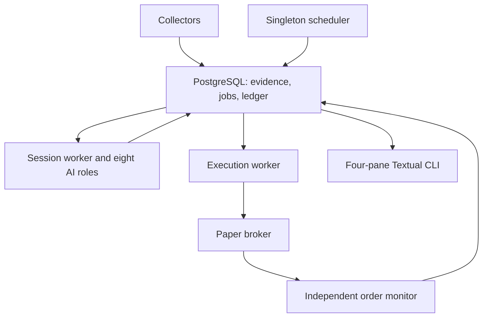

# Deployment, operating budgets, and cost estimates

[Wiki home](README.md) · [Project overview](../README.md)

Reviewed **2026-10-09**. Prices below are public reference rates and planning assumptions, not an account quote or measured project bill. Trading capital remains separate from all operating budgets.

## First runtime topology



Start locally with a virtual environment and PostgreSQL; containers are optional. The first development run is `research_only`: broker account/quote reads are permitted, orders are not. Enable `paper` only after deterministic reservations and recovery checks pass. Live mode is unsupported in the prototype.

For an always-on paper pilot, deploy supervised processes on one small Linux host or an equivalent service, with PostgreSQL persistence/backups. Keep a single scheduler; API replicas do not each start their own scheduler. If local development runs on a Mac, the same workers can run as separate terminal processes without Docker.

| Process | Planned responsibility |
| --- | --- |
| Scheduler | Enqueue collection every five minutes, sessions every X hours, and forecast settlement work |
| Collectors | Rate-limited source calls, cursors, retries, and durable evidence |
| Session worker | Coverage, analyst calls, fair debates, judgment, and Allocator proposals |
| Execution worker | Validate/reserve, dispatch durable paper intents, and reconcile unknown submissions |
| Order monitor | Broker updates, reconnect backfill, partial fills, protections, cash and daily-loss state |
| Terminal | One Textual window for positions, detail, read-only chatbot and portfolio/performance; services stay separate from model tools |

Market-closed sessions may research/report, but submission checks broker clock, quotes, and permitted trading hours. A source/model failure never disables the order monitor.

## Configuration to supply during implementation

| Setting group | Planned configuration |
| --- | --- |
| Runtime | Mode, database URL, exchange calendar/time zone, collection/decision intervals, session deadline |
| Instruments | Selected stocks, eligibility, CIK/aliases, benchmark and forecast horizon |
| Source access | Alpaca credentials, X bearer credential and approved author IDs, Tavily key/domains, SEC identifying user agent, IR/RSS registry, optional FRED key |
| Models | OpenRouter credential, model per role/stage, endpoint capabilities, reasoning/token/concurrency settings |
| Financial limits | Investable capital, cash reserve, maximum exposure/positions/concentration, stressed-loss budget, daily-loss and liquidity/freshness limits |
| Operating limits | LLM dollars/tokens, X returned-resource allowance, search credits, tool/verification counts, retry budget, maximum debates |
| Audit | Prompt/schema/policy versions, retention, log settings and checkpoint pruning |

Credentials stay in local environment/deployment secret storage, never committed or included in prompts. Typed policy/credentials and a local `--doctor` command now exist. A real source-capability probe and the full per-source operating-budget ledger remain planned; successful local configuration checks do not verify API access.

## Published reference prices

| Service | Reference on review date | Caveat |
| --- | --- | --- |
| OpenRouter Gemini 2.5 Flash | $0.30 per 1M input tokens; $2.50 per 1M output tokens | Verify serving endpoint, reasoning accounting, and model availability |
| OpenRouter Claude Sonnet 4.6 | Standard listed providers: $3 per 1M input; $15 per 1M output | Some routes list different rates; compare actual provider usage |
| X | Post reads $0.005/resource; user reads $0.010/resource | Resources returned matter; within-UTC-day deduplication is a soft guarantee |
| Tavily | Basic search 1 credit; advanced 2; 1,000 monthly free credits; pay-as-you-go $0.008/credit | Extraction/research and chosen paid plan change the bill |
| Alpaca equity market data | Individual Trading API Basic: free; Algo Trader Plus: $99/month | Basic is IEX; paper-only entitlements and news access need their own verification |
| Licensed publications, host/database | Not selected/quoted | Obtain source-specific access and deployment pricing before relying on a total |

No trading commission, publisher fee, tax, credit-funding fee, data entitlement, or infrastructure cost is implicitly included in the token estimates.

## Workload-derived model estimate

The **current** v0.1 graph uses four analysts and one lead per stock, one holding
review per holding, and eight debate turns, one judgment and one allocation per
debated stock:

```text
current baseline model calls = 5*N + H + 10*D
```

The 2026-10-10 demo run confirmed 47 stage calls for `N=3`, `H=2`, `D=3`. This is
fixture execution, not paid-model usage or a measured provider bill. With `N=10`,
`H=3`, `D=3`, the current baseline would be 83 calls before repairs/chat/verification.

The following **proposed optimized** session shares a Market briefing and makes one
portfolio-wide final allocation pass. These optimizations are not implemented:

```text
shared Market call                      = 1
Financial/Company/Social calls           = 3 * N
Financial Analyst lead/synthesis calls   = N
Allocator holding reviews               = H
Bull/Bear rounds plus Orchestrator judge = 9 * D
final Allocator portfolio pass           = 1
baseline model calls                    = 2 + 4*N + H + 9*D = 72
```

Verification, report repair, retries, resumed work, and extraction add calls. Eight sessions/day for 30 days is a deliberately stated 24/7 planning scenario; an exchange-hours policy produces a different count.

Assuming an average **6,000 billed input tokens and 1,000 billed output tokens per call**, including any billed reasoning in the output assumption:

| Model strategy | Approximate monthly model-only cost |
| --- | --- |
| All 72 calls on Flash | $74.30 |
| 44 analyst/lead/holding calls on Flash, 28 debate/final-allocation calls on Sonnet | $267.17 |
| All calls on Sonnet | $570.24 |

The mixed strategy changes an evaluation variable and is a later experiment. These estimates are not a maximum: long contexts and reasoning can cost substantially more. Measure actual usage during the first spike.

Further illustrative usage: 30 basic Tavily searches/session at the same cadence gives 7,200 credits/month and about **$49.60** after an applicable 1,000-credit allowance at pay-as-you-go rates. Averaging 100 billable X post reads/day gives about **$15/month**, excluding user resources and rereads across billing windows. Neither volume is guaranteed sufficient for the mandatory coverage matrix.

## Spending and recovery controls

Reserve estimated worst-case call cost before starting optional work, then reconcile actual usage. Reserve research capacity for holding checks ahead of optional debates; use a fair queue rather than probability/score priority. Configure both application caps and provider-console spending limits.

Quota/rate-limit responses use bounded backoff. Do not repeatedly pay for identical queries; cache permitted raw requests/results with cutoff and author/domain scope. If operating funds are exhausted, keep unresolved proposals queued/deferred and stop added exposure, while reconciliation/protection continue.

Report dollars/tokens by role/session/stock, source calls/credits, remaining budget, data freshness, queue age, source failures, unknown orders, and protection mismatches. Alert through the chosen operations channel once configured; no alert integration is implemented yet.

## Primary references

- [Flash rates](https://openrouter.ai/google/gemini-2.5-flash), [Sonnet rates](https://openrouter.ai/anthropic/claude-sonnet-4.6)
- [X billing](https://docs.x.com/x-api/getting-started/pricing)
- [Tavily credits](https://docs.tavily.com/documentation/api-credits)
- [Alpaca data plans](https://docs.alpaca.markets/us/docs/about-market-data-api)
- [APScheduler behavior](https://apscheduler.readthedocs.io/en/3.x/userguide.html)

## Related pages

- [Implementation stack](implementation-stack.md)
- [Connector implementation](connector-implementation.md)
- [Budget management](budget-management.md)
- [Implementation backlog](implementation-backlog.md)

