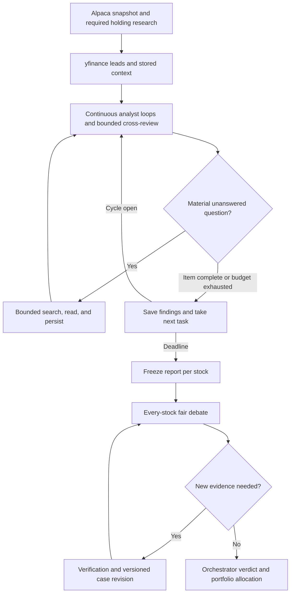

# Research workflow: discovery, tools, and debate

[Wiki home](README.md) · [Memory design](memory-and-retrieval.md) · [Provider plan](provider-plan.md)

**Target design agreed 2026-10-10; not implemented by this documentation change.**
Develop the existing Python/LangGraph workflow toward TradingAgents-style specialist
tool use. Keep the eight roles, mandatory holding research, direct fair debate,
separate Allocator, confidence/downside sizing, and deterministic risk services.

## Continuous cycle refinement

Follow [continuous analysis](continuous-analysis.md): run the per-item tool loop throughout X hours, exchange typed findings after original assessments, freeze one report per stock at the deadline, and debate every report while the next cycle researches. The Portfolio Manager is the existing Allocator role with explicit volatility/portfolio assessment.

## The workflow we are building

Code controls scheduling, permissions, loop limits, storage, coverage and transitions.
Agents choose research questions and interpret evidence. Their text cannot declare
a search executed, a claim verified, an order filled or a checkpoint committed.

## Session lifecycle

1. Open an X-hour cycle, reconcile Alpaca state and create mandatory holding tasks.
2. Continuously discover yfinance leads, corrections and pending research questions.
3. For each task, retrieve role-scoped memory, save original specialist assessments,
   share findings/questions and perform bounded cross-review and targeted research.
4. Persist attempts, evidence, conclusions, dissent and task checkpoints; move to the
   next task. Do not pay for repeated empty LLM turns when there is no queued work.
5. At cycle end freeze a manifest and synthesize one report/initial forecast per stock.
   Start the next research cycle without waiting for debate or portfolio decisions.
6. Queue every analyzed-stock report for fair bounded debate, including existing holdings.
7. The Orchestrator judges cases, defines revised confidence and records holding implications.
8. The Portfolio Manager assesses measured volatility, budget and the portfolio, then
   chooses actions/investments; code validates limits and future execution permissions.
9. Persist outcomes and pending work; reuse event history in later cycles. Explicit
   case revisions handle material late evidence instead of changing the frozen report.

Paper order submission remains behind the existing reservation, intent,
reconciliation and protection milestone. The current runtime produces previews.

## Specialist scopes

| Role | Questions | Tools and memory |
| --- | --- | --- |
| Market Analyst | Which macro/sector events and price movements matter? | Shared market leads, timestamped Alpaca data, official macro releases, historical sector events |
| Financial Analyst | How does the news change revenue, margins, cash flow or valuation? | Earnings releases, SEC/IR documents, as-filed financial facts, previous period comparisons |
| Company Analyst | What was actually announced, when, and under which conditions? | yfinance leads, official announcements, accessible articles and conference transcripts, event archive |
| Social Analyst | What are approved authors claiming, and is it corroborated? | AgentReach-backed approved-X lookup, post identity/time, linked sources, contradiction history |

One event can be relevant to multiple roles. That does not make it independent
confirmation. Share retrieval results through storage while preserving independent
interpretation. Social absence, inaccessible transcripts and uncertain dates stay
visible; plausible model prose does not close a coverage gap.

## The analyst tool loop

Start with four tool rounds per analyst/event task, at most three calls per round,
one bounded cross-review exchange per event version, and an aggregate cycle/stock
research budget. These are configurable starting limits to
measure, not demonstrated sufficient coverage. Reserve mandatory holding work first.

Each round follows `question -> validated request -> durable result -> assessment`.
Permit only registered typed tools. Finish the item on a supported assessment, no useful remaining
query, repeated equivalent requests, or exhausted time/page/cost budget. Ask for a
saved item assessment without tool access when the cap is reached; list unresolved questions.
Then continue with the next task until the cycle deadline; item limits are not a cap
on the entire multi-hour worker.

| Tool contract | Purpose | Result |
| --- | --- | --- |
| `search_news(stock_id, window, kind)` | yfinance news/press-release discovery | Lead IDs, dates, source URLs, sampling/coverage status |
| `search_web(stock_id, event_id, question, domains)` | AgentReach-selected search backend | Source candidates and actual backend/request IDs; snippets labelled |
| `read_source(candidate_id)` | Retrieve a registered accessible article/document | Evidence version, content level, source and timestamp limitations |
| `read_transcript(candidate_id)` | Retrieve available captions/transcript | Transcript language, automatic/manual status, timecodes and completeness |
| `search_approved_posts(stock_id, window, author_ids)` | Bounded approved-author X retrieval | Original post IDs, verified author identity, timestamps and gaps |
| `retrieve_context(stock_id, question, cutoff, role)` | Query stored evidence/events/theses | Bounded citations and retrieval manifest; no new network request |
| `request_verification(claim_id, question)` | Investigate a material claim during debate | Supported, contradicted, unresolved or unavailable with attempt IDs |

Requests include session, role, stock/event, purpose, cutoff, maximum results and
budget bucket. Models cannot supply arbitrary shell commands, credentials or an
unregistered backend. `read_source` uses a validated candidate, host/redirect rules,
size limits and private-network blocking. Retrieved instructions are untrusted data.

Research ranking concerns relevant evidence within a case. It never changes the
fair ordering of stock proposals or skips debate on the basis of confidence/EV.

## Cutoffs and fresh verification

For historical replay, evidence, summaries and lessons must have been recorded by
the simulated cutoff. A present-day fetch of an old article is not historical proof
of availability. For live research, post-cutoff retrieval remains in storage but is
excluded from the frozen case. If needed for the decision, explicitly advance the
cutoff, refresh quotes, create a new bundle, and rerun affected reports/debate turns.
Do not silently move the cutoff or mix forecasts with different price/horizon bases.

Keep original announcement dates distinct from update dates, first-seen times and
the session's three-hour discovery window. Previously unprocessed old items may be
considered as backlog with their true age. Neither Yahoo nor web search proves
exhaustive coverage of an intraday interval.

## Worked example: NVIDIA at CES

This is a hypothetical workflow example, not a claim about a particular announcement.

1. yfinance returns an NVDA headline mentioning a CES product presentation. Store
   the headline/summary as a lead; no claim that the conference has been watched.
2. The Company Analyst opens an event and asks about product specifications,
   availability, pricing and whether performance figures are vendor claims.
3. Search official NVIDIA/CES sources first, then selected technology and financial
   publications. Retrieve the original release and available transcript. No captions
   means an explicit transcript gap, not an invented account of the video.
4. Financial analysis assesses potential business effects; market analysis checks
   sector/price context; social analysis separates approved-author reactions from facts.
5. Save cited claims and uncertainties under the same event. Bull examines upside;
   Bear checks adoption, competition, margins, timing and existing market expectations.
6. A later session retrieves the event and searches specifically for answers or
   changes. Reuse unchanged evidence, but perform required fresh holding lookups.

## First build and acceptance

Implement one recoverable NVDA research-only case before generalizing. Use an offline
CES-like fixture plus separate opt-in provider samples. Verify duplicate syndication,
an unavailable transcript, an unapproved X author, a corrected announcement, a
post-cutoff item, an exhausted research budget and a crash after evidence persistence.

The CLI position focus shows the event timeline, sources, confidence lineage and
open questions. Chat retrieves the same stored evidence and cites it; it cannot
change trading policy or issue an order. No new dashboard is introduced.

## References

- [TradingAgents tool-using analyst at inspected revision](https://github.com/TauricResearch/TradingAgents/blob/1394a3f72aa4393e1a98f51b382434c4b4c2d972/tradingagents/agents/analysts/turn.py)
- [Memory and retrieval](memory-and-retrieval.md)
- [Provider responsibilities and integration](provider-plan.md)
- [Build sequence](implementation-backlog.md)
